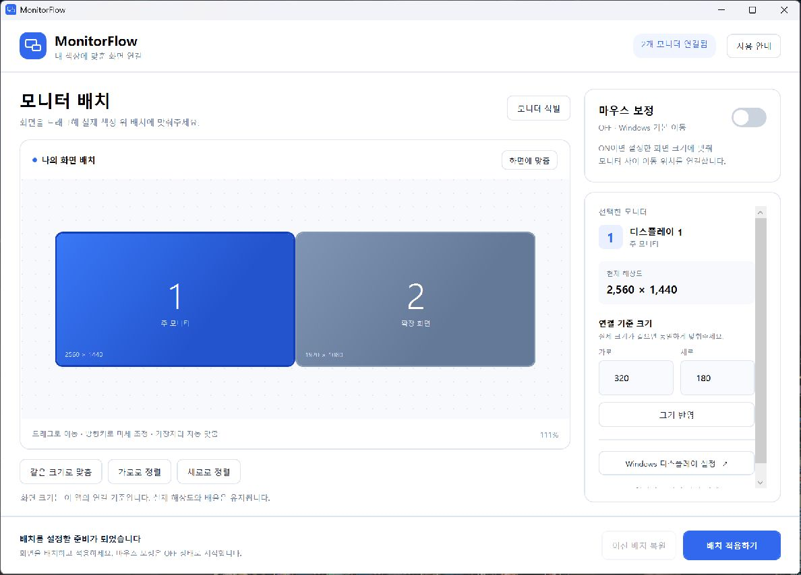

# MonitorFlow

**해상도는 그대로, 내 책상에 맞춰 모니터를 연결하세요.**

MonitorFlow는 Windows용 모니터 배치 및 마우스 경계 이동 보정 프로그램입니다. 앱에서 화면 크기와 배치를 실제 모니터에 맞추면, 해상도가 다른 화면 사이에서도 같은 높이로 이동하도록 마우스 좌표를 보정합니다. 배치를 적용하면 Windows 디스플레이 설정의 **위치**도 함께 바뀝니다.

[**최신 실행 파일 다운로드**](https://github.com/glasscola/MonitorFlow/releases/latest) · [캡처로 보는 PDF 설명서](docs/MonitorFlow-Manual-KO.pdf) · [사용 안내](docs/사용안내.md)



## 주요 기능

- 연결된 모니터 자동 인식과 드래그 배치
- 같은 크기로 맞춤, 모니터별 가로·세로 상대 크기 조절
- 가장자리 자동 맞춤, 가로·세로 정렬, 방향키 미세 조정
- Windows 디스플레이 위치 동기화와 15초 확인 후 자동 복원
- 마지막으로 적용한 크기·배치에 따른 마우스 보정 ON/OFF
- 즉시 중지 단축키, 트레이 실행, 이전 배치 복원
- 연결·해상도·외부 배치 변경 감지 시 보정 중지

## 다운로드와 실행

1. [Releases](https://github.com/glasscola/MonitorFlow/releases/latest)에서 `MonitorFlow.exe`를 받습니다.
2. 파일을 실행합니다. 배포 EXE에는 .NET 런타임이 포함되어 별도 설치가 필요하지 않습니다.
3. **모니터 식별**로 번호를 확인하고, 화면을 실제 책상 위 위치로 드래그합니다.
4. 실제 크기가 같으면 **같은 크기로 맞춤**을 누릅니다. 크기가 다르면 오른쪽 **연결 기준 크기**를 조절합니다.
5. **배치 적용하기**를 누르고, 위치가 맞으면 15초 안에 **이 배치 유지**를 선택합니다.
6. **마우스 보정 ON**을 켭니다.

지원 환경: Windows 10/11, x64. Windows의 확장 디스플레이 모드를 대상으로 합니다.

## 크기와 위치는 어떻게 적용되나요?

| 항목 | 동작 |
| --- | --- |
| 앱의 화면 크기 | 실제 모니터의 크기 관계를 나타내는 연결 기준입니다. |
| 앱의 화면 위치 | **배치 적용하기**를 누르면 Windows 위치에도 반영됩니다. |
| 실제 해상도·Windows 배율·주 모니터 | 변경하지 않습니다. |
| Windows 설정의 모니터 사각형 크기 | 기존 해상도 기준으로 유지됩니다. |
| 마우스 보정 ON | 마지막으로 적용한 크기와 배치에 맞춰 경계를 넘는 위치를 보정합니다. |
| 마우스 보정 OFF | Windows 기본 마우스 이동을 사용합니다. 적용한 모니터 위치는 유지됩니다. |

예를 들어 실제 크기가 같은 QHD·FHD 모니터는 앱 안에서 같은 크기로 맞출 수 있습니다. 각 화면은 원래 해상도를 유지하고, 보정 ON 상태에서 화면의 같은 높이로 연결됩니다. 편집 중인 변경은 **배치 적용하기**를 눌러야 반영됩니다.

## 단축키와 종료

| 기능 | 단축키 |
| --- | --- |
| 보정 즉시 중지 | **Ctrl + Alt + Shift + M** |
| 앱에서 보정 ON/OFF | Ctrl + M |
| 앱에서 배치 적용 | Ctrl + Enter |
| 선택한 화면 위치 미세 조정 | 방향키 / Shift + 방향키 |

보정 ON 상태에서 창을 닫으면 트레이에서 계속 실행됩니다. 트레이 아이콘을 두 번 클릭하면 창이 열리고, 메뉴의 **종료**는 보정도 종료합니다. 보정 OFF 상태에서 창을 닫으면 앱이 종료됩니다.

다시 실행하면 보정은 OFF로 시작합니다. 시작 시 Windows 위치를 자동으로 변경하지 않습니다. 위치까지 되돌리려면 **이전 배치 복원**을 사용하세요.

## 여러 모니터와 알려진 제한

2·3·4개를 포함한 여러 화면의 상하좌우 연결을 처리하는 구조입니다. 화면은 서로 겹치지 않고 가장자리가 이어져야 하며, 모서리 한 점만 닿는 배치는 연결로 취급하지 않습니다.

해상도가 다른 화면의 일부 2×2 또는 복잡한 배치는 Windows 픽셀 좌표로 바꿀 때 화면 영역이 겹칠 수 있습니다. 이 경우 적용을 중단하고 수정 방법을 안내합니다. 가로·세로 정렬이나 화면 높이 오프셋을 조절해 주세요.

일반 Windows 데스크톱의 상대 마우스 입력을 대상으로 합니다. 독점 전체 화면 게임, 포인터를 가두는 앱, 절대 좌표 펜·태블릿, 원격 데스크톱은 별도 호환성 검증 대상입니다.

## 설정 저장

설정은 `%LOCALAPPDATA%\MonitorFlow\layout.json`에 저장합니다. 확인 중인 배치의 복구 정보는 `pending.json`에 남깁니다. 비정상 종료 후 복구 정보가 있으면 **이전 배치 복원**으로 돌아갈 수 있습니다.

클라우드 전송, 계정 로그인, 자동 시작 등록은 없습니다.

## 소스에서 빌드하기

Windows와 [.NET 10 SDK](https://dotnet.microsoft.com/download/dotnet/10.0)가 필요합니다. 애플리케이션의 외부 NuGet 라이브러리 의존성은 없습니다.

```powershell
# 로컬 빌드
dotnet restore MonitorFlow/MonitorFlow.csproj
dotnet build MonitorFlow/MonitorFlow.csproj -c Release --no-restore

# 기하 계산 테스트
dotnet run --project MonitorFlow.Tests/MonitorFlow.Tests.csproj -c Release

# 런타임을 포함한 단일 EXE
powershell -File ./build.ps1
```

단일 EXE는 `release/MonitorFlow.exe`에 생성됩니다. 첫 배포 빌드에서는 Microsoft .NET 런타임 패키지를 다운로드합니다.

```powershell
# 실제 Windows 설정을 변경하지 않는 3화면 미리보기
.\release\MonitorFlow.exe --demo

# 화면 조회 및 보정 엔진 등록·해제 진단
.\release\MonitorFlow.exe --diagnostics C:\path\diagnostics.json
```

코드 구조와 배포 과정은 [개발 안내](docs/DEVELOPMENT.md)를 참고하세요.

## 검증 범위

- 기하 계산 테스트 19개: 2·3·4개 화면, 상하좌우 전환, 음수 좌표, 막힌 경계, 크기 변경, 해상도 유지, 잘못된 배치 등
- 실제 QHD + FHD 환경: 화면 조회, Windows 위치 변경, 15초 자동 복원
- 실제 앱: 마우스 보정 ON/OFF와 즉시 중지 단축키
- 네이티브 마우스·키보드 훅과 Raw Input 등록·해제 반복

실제 하드웨어 마우스로 경계를 넘을 때의 이동감은 각 사용 환경에서 추가 확인이 필요합니다. 자동화 마우스 입력은 보정 대상에서 제외됩니다.
